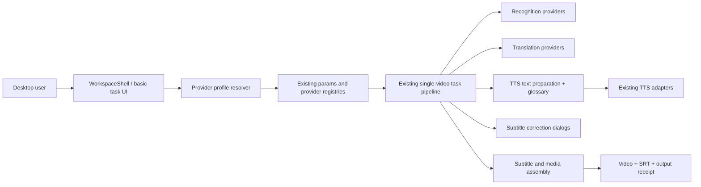
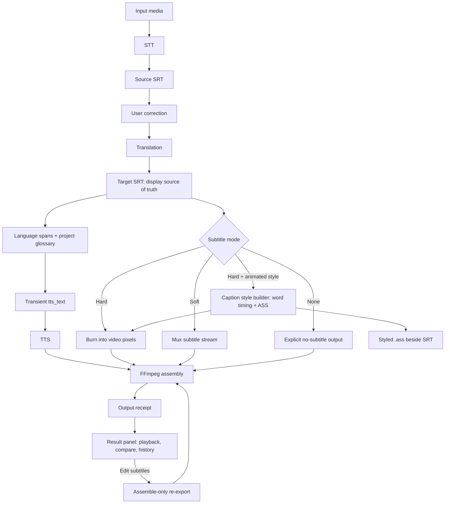
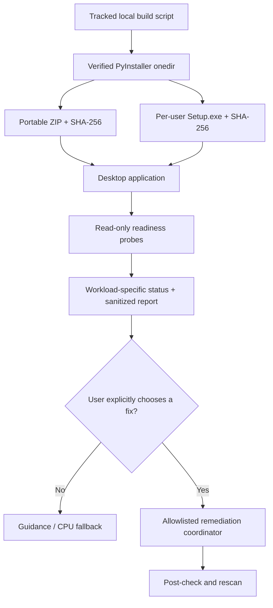

# Architecture — Vietnamese-first workflow extension

## DHSYSTEM organization context

No organization profile is configured. The architecture preserves upstream licensing and project identity metadata.

## System overview

ENH-004 is an incremental layer over the current PySide6 task pipeline. It changes presentation defaults and adds reversible configuration/profile and TTS-text preparation boundaries. It does not replace recognition, translation, TTS or FFmpeg assembly implementations.

Diagram source: `.DHSYSTEM/architecture/system-overview.mermaid`.

## Data flow

Diagram source: `.DHSYSTEM/architecture/data-flow.mermaid`.

## ENH-009 extension — guided workflow, result review and animated captions

Source: `docs/brainstorm/session-2026-10-22-guided-workflow.md`; UI direction `.DHSYSTEM/ui-direction/2026-10-22-guided-workflow/` (pages: `step1-video`, `step2-options`, `step3-result`, `captions`, `providers`).

- **Provider visibility (Phase 8):** the curated set in `ui/provider_visibility.py` narrows to online-no-key, OpenAI/Gemini/OpenRouter, local and custom endpoints; the show-all switch moves to Advanced. Presentation-only.
- **Result panel (Phase 9):** `ui/result_panel.py` consumes `output_receipt` only; Qt Multimedia playback; assemble-only re-export; receipt history JSON in user data.
- **Guided wizard (Phase 10):** `ui/wizard/` routes inside `WorkspaceShell`, writes existing params and starts jobs through `win_action.check_start`; `ui_mode` toggles back to the classic workspace.
- **Animated captions (Phase 11):** pure `util/caption_styles.py` builds ASS (`\kf`, BorderStyle 3, `\fad`) from final SRT cues; new `caption_style` param; hard subtitles only; bundled Be Vietnam Pro font passed to libass via `fontsdir`. No Node/Remotion.

## Component decisions

| Component | Decision | Rationale |
| --- | --- | --- |
| Subtitle editor | Repair current `QTableWidget` dialogs | Lowest-risk fix; current data contracts already exist |
| Provider profiles | Mapping layer over current registries/params | Avoids persisted enum breakage and keeps advanced providers reachable |
| TTS pronunciation | Separate `tts_text` preparation service | Protects subtitle fidelity and makes glossary behavior testable |
| Animated captions | ASS + bundled FFmpeg/libass | Remotion-style word highlight without Node/Chromium in the Windows package |
| Result review | Qt Multimedia `ResultPanel` fed by `output_receipt` | Already bundled; keeps task internals out of widgets |
| VieNeu | External loopback OpenAI-compatible pilot | Avoids dependency conflicts and keeps packaging unchanged during evaluation |
| Subtitle default | Hard subtitle for fresh main workflow | Matches user expectation that captions are immediately visible |
| Provider removal | Deferred until audit/migration task 4.17 | Prevents configuration loss and unsupported assumptions about local models |

## Diagram applicability matrix

| Diagram | Status | Rationale |
| --- | --- | --- |
| system-overview | required | ENH-004 affects UI, profiles and three processing stages |
| data-flow | required | Visible SRT and transient TTS text must remain separate; ENH-009 adds caption-style and result-review paths |
| event-flows | optional | Dialog events are sufficiently specified in task 4.13 |
| module-dependencies | optional | Detailed imports belong to implementation design |
| deployment | required for Phase 5 | Portable/installer boundaries, writable user data and consent-based remediation must remain explicit |
| user-use-case | N/A | User outcomes are captured in PROJECT-CONTEXT |

## Deployment and runtime

The packaged app remains a Windows onedir PyInstaller application. VieNeu runs as an optional local companion process on loopback during the pilot. Gemini/OpenRouter-compatible profiles are outbound API integrations and must remain optional.

ENH-005 adds two local distribution wrappers around the same verified onedir tree: a portable ZIP and a per-user Windows installer. Required application runtime assets remain bundled; writable settings/models/logs/output remain outside the install tree. A pure readiness service feeds a localized UI and a separate allowlisted remediation coordinator. The scanner never owns provider selection or media processing.

Diagram source: `.DHSYSTEM/architecture/deployment.mermaid`.

## Open architecture questions

- Exact persisted schema for provider profiles and project glossary.
- Whether code-switch detection should be deterministic-only in Phase 4.16 or optionally LLM-assisted after a privacy review.
- How long English spans must be before dual-voice synthesis is offered.
- Which prerequisite checks are actually required by the final frozen candidate versus merely recommended for optional GPU/local-model workloads.
- Whether code signing is available for locally shared Setup/portable artifacts; unsigned builds must document Windows SmartScreen expectations truthfully.
